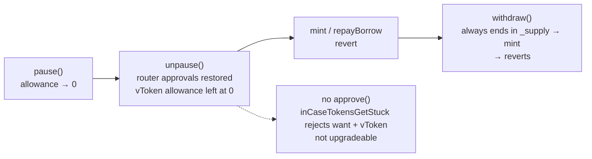
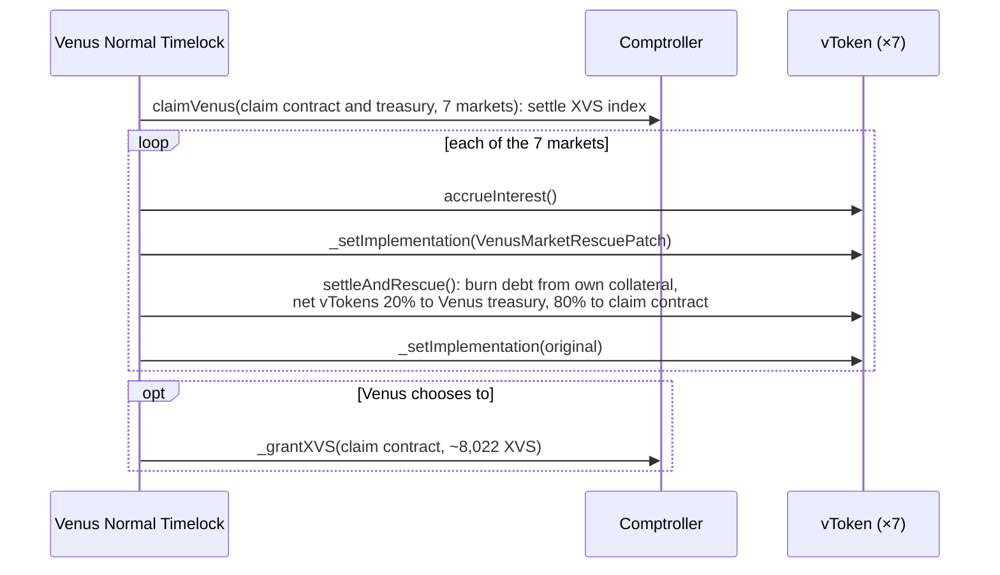
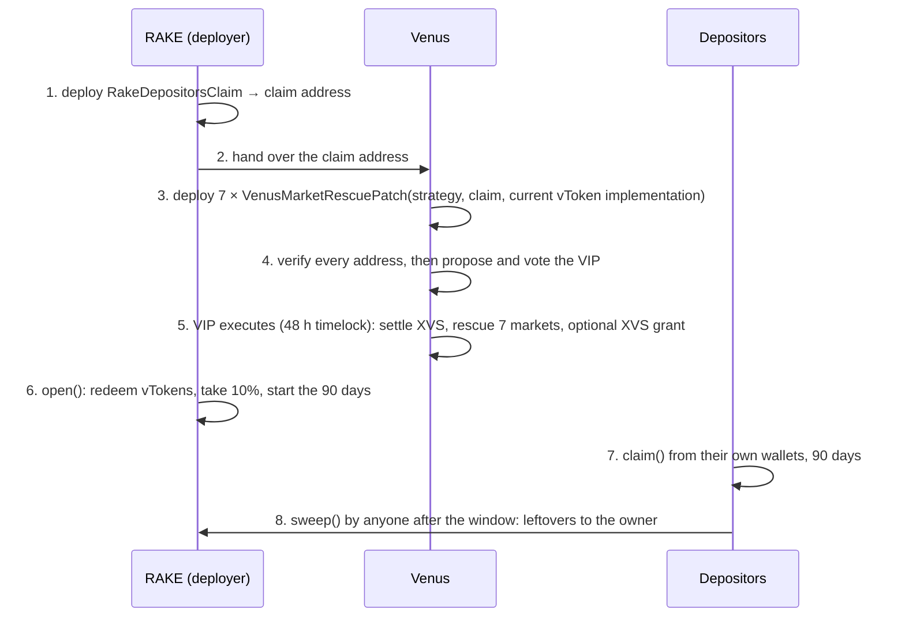
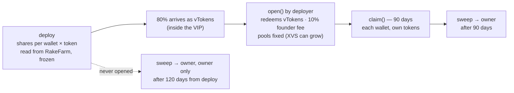
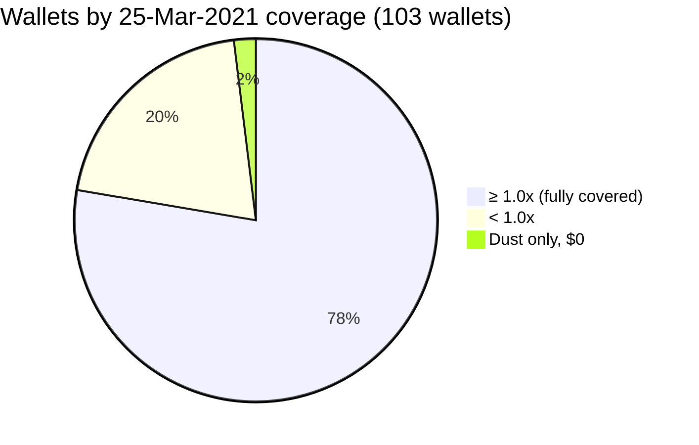

# Technical appendix

Code: `contracts/src/` · Tests: `contracts/test/` · Data: `data/` · Scripts: `contracts/script/`

---

## A1. The bug, and why there is no owner-side fix



- RAKE launched at block 5,195,791 (25 Feb 2021, 20:35 UTC). All seven strategies were paused 1 h 20 min later; the `unpause()` calls at blocks 5,199,574–5,203,969 left the want→vToken allowance at 0.
- The bug in `StratVLEV.unpause()`: `IERC20(wantAddress).safeApprove(vTokenAddress, 0); // should be uint256(-1)`.
- No route out from the owner side:

| Route | Result |
|---|---|
| `withdraw()` at 10/50/72/100% on each of the 7 pools | 28 of 28 revert |
| `pause()` again | sets the allowance to 0 again |
| `inCaseTokensGetStuck` | rejects `want` and `vToken` |
| `rebalance`, `earn`, `deleverageOnce` | revert, or no-op on vBUSD |
| `leverageOnce` | not in the deployed bytecode |
| Self-liquidation (`liquidateBorrow` on vBTC, vETH) | `3 = COMPTROLLER_REJECTION`: the positions are healthy |

The strategies' owner is `0x16c7C45725A977ae6530e8dEE73F6da9aE2e7E07`. The vTokens are proxies whose admin is the Venus Normal Timelock, and that is the only lever left.

**Where part of the BUSD position went.** The position's equity peaked at about 315,956 BUSD in mid-2023. After Venus wound down BUSD, the market stopped paying supply interest while the frozen borrow kept accruing, which cost about 57,000 BUSD. On 27 October 2023 the position was liquidated through Venus's Liquidator in one transaction (`0x40c6147f55b66c4b11a4780723e0e92756000cce0634c342f2366fa1f0370273`): it repaid the 521,222 BUSD borrow and seized 573,344 BUSD of collateral, a 52,123 BUSD penalty. 206,755 BUSD remains, with no debt, and is part of this recovery.

---

## A2. The rescue: one VIP transaction



The debt math: retiring borrow `d` while burning `d / ER` vTokens leaves the exchange rate unchanged.

```
ER = (cash + borrows − reserves) / supply
(N − d) / (TS − d/ER) = N / TS = ER
```

- `VenusMarketRescuePatch`: the strategy, the claim contract and the original implementation are fixed at deploy; the Venus treasury `0xF322942f644A996A617BD29c16bd7d231d9F35E9` and the 20% are constants. Only the market's live `admin()` can call it. It reverts if interest is not accrued this block, if the collateral is below the debt, or if the exchange rate falls.
- The claim contract holds its 80% as vTokens until `open()`, which redeems them through the ordinary Venus redeem path. The VIP does not open the claim window.
- **Timelock:** the Normal Timelock (48 h delay) is the admin of all seven vTokens, so the VIP must run through it.
- **Storage writes:** The patch writes the market's storage directly and skips the comptroller hooks (XVS indexes, Prime). That is safe here because both receivers' XVS is settled first and none of the strategies is a Prime holder.
- **XVS:** because both receivers' XVS is settled first, the recovery earns 0 XVS. Without that step, about 3,246 XVS of back-dated rewards would be credited to the claim contract.
- **Addresses to verify before the vote:** the 7 strategies, the 7 markets, the 7 rescue patches, the treasury and the claim contract. RAKE supplies the claim contract address once terms are agreed; Venus deploys the 7 rescue patches bound to it.

### Who does what, when



| Step | Who | Needs |
|---|---|---|
| 1. Deploy the claim contract (`DeployRakeDepositorsClaim`) | RAKE | nothing (all inputs are in the code); the deployer becomes owner |
| 2. Hand over the claim address | RAKE → Venus | `addresses.json` |
| 3. Deploy 7 rescue patches (`DeployVenusMarketRescuePatches`) | Venus | per market: the strategy, the claim address, the vToken's current `implementation()` |
| 4. Verify and vote | Venus | `addresses.json`, this repo's tests |
| 5. Execute the VIP | Venus Normal Timelock | — |
| 6. `open()` | RAKE, after step 5 is on-chain | — |
| 7. `claim()` | each depositor | their own wallet |
| 8. `sweep()` | anyone, after 90 days | — |

If Venus changes a market's implementation between steps 3 and 5, that market's patch must be redeployed with the new implementation and the VIP updated.

---

## A3. The claim contract



| Share of total | |
|---|---|
| Venus | 20% |
| Founder fee | 10% |
| Depositors | 70% |

- **Entitlement:** a wallet's cut of a token = pool × (wallet's farm shares ÷ strategy `sharesTotal`), both fixed at deploy. No amounts are typed in. The recorded shares sum to each pool's total, so the 103-wallet list is complete. One wallet (`0x667cBbEd2E1295EC25381e2b056547eb90FC8F96`) holds a single share of the BUSD pool, worth less than 1 wei, so it receives nothing.
- **Rules:** `open()` needs every token balance > 0. Claims are paid only to `msg.sender`, with per-token flags so one token that refuses a transfer blocks only itself. A hard cap stops any token paying out past its pool. Before `open()`, only the owner can sweep, so a VIP that lands late can still be opened.
- **XVS (optional, up to Venus, stays open):** Venus may send XVS at any time, in any number of transfers, before or after `open()`; each arrival is fee'd once and claimable during the window. A wallet's XVS cut = XVS pool × Σ(pool weight × wallet shares ÷ total) ÷ Σ weights. The weights are the XVS each strategy earned (vETH 2,025 · vBUSD 1,887 · vUSDC 1,706 · vBTC 1,423 · vLINK 481 · vUSDT 421 · vDOT 79).
- **Can every wallet claim?** No depositor is a contract. 9 of the 103 carry EIP-7702 delegation code (`0xef0100…`); these are key-held wallets that call `claim()` directly.
- **Entitlement table:** `data/depositor_share_of_each_frozen_pool.csv` gives each wallet's % of each pool, read from RakeFarm `userInfo` ÷ `sharesTotal`. The 103 wallets sum to 100.000000% of every pool; `DeployRakeDepositorsClaimTest` checks that the recorded shares cover every pool. Amounts = % × the pool's depositor share on the day the funds arrive.
- **Claim site:** https://rakeclaim.com

---

## A4. The 2021 compensation data



| Basis | Wallets ≥ 1.0x | Aggregate shortfall |
|---|---:|---:|
| First 7 days | 56 of 103 | $15,592 |
| To 25 March 2021 | 80 of 103 | $4,130 |

- Coverage per wallet = USD value of the RAKE that wallet earned from the frozen pools ÷ its frozen equity. Only rewards from the 7 frozen pools are counted.
- Frozen equity is valued at 24 July 2026 prices (BSC block 114,966,322, total $972,308).
- Dust wallets: 2 (`0x037ea234207D23A14d1c155fd58B57655A338a17`, `0x667cBbEd2E1295EC25381e2b056547eb90FC8F96`) hold 1 farm share each, worth $0, so they have no coverage ratio.
- Wallets that never sold RAKE: 6, with a combined frozen equity of $68 (including the 2 dust wallets).
- Founder wallet: 9,702.43 RAKE minted; 8,933.66 (92.08%) never moved; 4.5 RAKE (0.046%) sold.
- Source: `data/depositor_2021_rake_compensation.csv` (one row per wallet; columns explained in `data/README.md`).

---

## A5. Tests and reproduction

```
cd contracts
forge install foundry-rs/forge-std --no-git
forge test --match-contract '^RakeDepositorsClaimTest$'                   # unit, no RPC
FORK_BLOCK=<block> BSC_RPC_URL=<BSC archive RPC> forge test                # everything, on a BSC fork

forge script script/RescueAmounts.s.sol --fork-url $BSC_RPC_URL --fork-block-number 131610085
                                     # the proposal's figures: $1,074,900 at Venus oracle prices
forge script script/DeployRakeDepositorsClaim.s.sol --rpc-url $BSC_RPC_URL --broadcast
                                     # RAKE: deploy the claim contract; recorded in addresses.json
forge script script/DeployVenusMarketRescuePatches.s.sol --rpc-url $BSC_RPC_URL --broadcast
                                     # Venus: deploy the 7 rescue patches; recorded in addresses.json
forge script script/VenusRescueProposal.s.sol --fork-url $BSC_RPC_URL
                                     # the proposal: targets, values, signatures, calldatas
```

| Script | What it does | Its test |
|---|---|---|
| `RescueAmounts` | read-only: each position's net value (tokens, USD at Venus oracle prices) and the 20/10/70 split | n/a (it only reads) |
| `DeployRakeDepositorsClaim` | RAKE: deploys the claim contract (deployer = owner, fee recipient, beneficiary) | `DeployRakeDepositorsClaimTest` |
| `DeployVenusMarketRescuePatches` | Venus: deploys one `VenusMarketRescuePatch` per market bound to its strategy, the claim contract and the market's current implementation | `DeployVenusMarketRescuePatchesTest` |
| `VenusRescueProposal` | builds the 30 commands (31 with the XVS grant) and prints them in `GovernorBravo.propose()` form | `VenusRescueProposalTest` sends those exact bytes from the Timelock |

| Suite | What it proves | Result |
|---|---|---|
| `RakeDepositorsClaimTest` | pro-rata split, fee, 90-day window, owner-only 120-day emergency sweep, XVS weighting and late XVS, no double claim, claimable = 0 after the window | 20 / 20 |
| `VenusRescueProposalTest` | the proposal's exact commands on a BSC fork: 20/80 split, `open()` redeems every vToken, admin-only patch, XVS settle = 0, optional XVS grant, other suppliers unchanged on all 7 markets; full chain VIP → open → all 103 wallets claim exactly their share → pools empty to dust → sweep; a late VIP cannot be swept by a third party | 9 / 9 |
| `PostRescueRakeFarmSafetyTest` | after the rescue: nobody can deposit, inflate farm shares or withdraw twice; depositors then claim | 1 / 1 |
| `DeployRakeDepositorsClaimTest` | claim contract owned by the deployer, tokens in market order, all 103 depositors snapshotted | 2 / 2 |
| `DeployVenusMarketRescuePatchesTest` | each patch bound to its strategy, the claim contract, the treasury and the current implementation; refuses to deploy if a market's implementation changed | 2 / 2 |
| `VenusMarketRescuePatchTest` | debt settled from the strategies' own collateral, exchange rate never falls, admin-only, one-shot | 5 / 5 |

Fork runs were made at BSC block 131,658,996 (39 / 39 pass).
