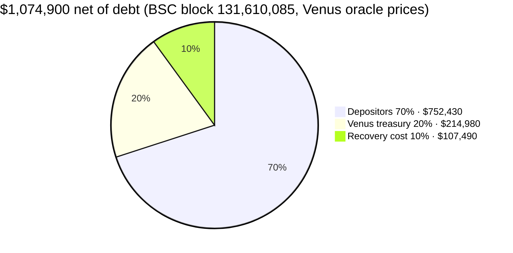
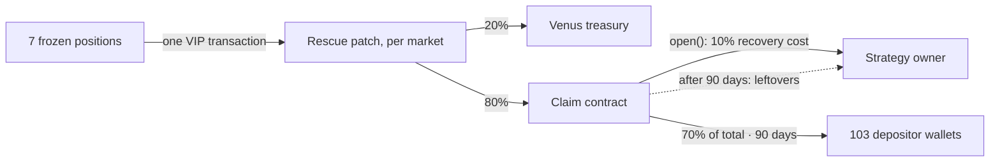

# Returning RAKE's frozen Venus funds to depositors

**Proposer:** RAKE founder and owner of the affected strategy contracts
**Contact:** Discord 5ubse7en · f0r3x_shark@protonmail.com

## Summary

Since February 2021, about $1,075,000 of depositor funds has been frozen in seven Venus markets by a bug in RAKE's own strategy contracts. Only a Venus governance action can release it.

We ask Venus to approve one atomic transaction that settles each frozen position's debt from its own collateral, pays Venus 20%, and sends the rest to a claim contract. Each of the 103 depositors then withdraws their share from their own wallet. Nobody holds the funds in between.

Depositors have 90 days from when the claim window opens. Unclaimed funds then go to the contract owner.

## 1. What happened

RAKE, an auto-compounding farm on BNB Chain, launched on 25 February 2021 with single-asset vaults that supplied to Venus: BUSD, BTC, ETH, LINK, USDT, USDC and DOT. About 80 minutes after launch we paused deposits as a precaution. The strategy code, an outdated copy of AutoFarm's leveraged Venus strategy, un-pauses without restoring the vault's permission to use its Venus market, so none of the seven could supply, repay or withdraw again.

Our owner keys cannot fix it. No function restores the permission, the contracts cannot be upgraded, and the emergency function excludes these exact tokens. We tested every route, including liquidating our own positions. Only Venus, which controls the markets, can act. *(Appendix A1.)*

## 2. What we did in 2021

We compensated depositors at our own expense. The frozen vaults kept their full RAKE rewards, and the founder stopped selling their allocation, their only pay. That allocation was at least as large as what the frozen pools earned, so every RAKE the founder did not sell left depositors the liquidity they needed to sell theirs. In effect, the founder's pay went to them. On-chain today:

- **92% of the founder's RAKE has never moved.** Only 0.046% was ever sold.
- **80 of 103 affected wallets** had received RAKE worth more than their whole frozen position by 25 March 2021, counting only the frozen pools. 21 were short about $4,100 in total, and 2 hold only dust ($0).
- **97 of 103 wallets sold their RAKE.** The six that never sold hold under $70 frozen.

Coverage uses 24 July 2026 prices (block 114,966,322). *(Appendix A4.)*

## 3. Why now

We first raised this with Venus in 2021, Venus had a full plate at the time due to unrelated events, so we put our focus on compensating affected users through the above means. Since then we hired an expert to ensure we have exhausted all options in our power to recover the funds and are confident it will require action from Venus. We have also completed development of the scripts, contracts and frontend that will be required to do a proper recovery. This proposal is coming after significant communication with the Venus team.

- **The debt keeps growing.** It accrues interest nobody can repay.
- **Venus's own risk actions erode the positions.** When DOT was deprecated as collateral, the DOT position was liquidated sixteen times in under a minute. LINK is exposed to the same.
- **Unmanageable positions are a liability** on Venus's books.

## 4. The proposal

**One transaction.** For each market, the VIP swaps in a narrowly scoped rescue patch. The patch settles the position's debt from its own collateral and moves the net vTokens, 20% to the Venus treasury and 80% to the claim contract. The VIP then restores the original contract. The exchange rate and cash do not change, so other suppliers lose nothing. If any step fails, everything reverts. No capital is advanced and nobody has to forward funds. *(Appendix A2 and A5.)*

**Who deploys what.** RAKE deploys the claim contract. Venus deploys the seven rescue patches bound to it, so the VIP only runs code Venus deployed. Every address is in `addresses.json`.

**How depositors claim.** The claim contract records each wallet's farm shares at deployment, read from RAKE's farm. Nobody types in an amount. Each depositor claims from the wallet they deposited with and receives their share of each pool in the original token. Every wallet's share is published in [depositor_share_of_each_frozen_pool.csv](data/depositor_share_of_each_frozen_pool.csv). *(Appendix A3.)*

**Fees.** Venus 20%, for the governance action and the review. Recovery cost 10%. Depositors 70%. Neither fee depends on how many depositors claim.

**Unclaimed funds.** After the 90 days, what is left goes to the strategies' owner. Since these events happened in 2021, a significant portion of the affected wallets are now inactive, lost or compromised. Sending tokens to them automatically would only result in permanent loss. The owner is a party to this recovery, since the positions sit in the owner's contracts. The owner also bore the cost of the 2021 compensation and paid for the work behind this recovery. If the window is never opened, the owner can sweep after 120 days, so nothing is locked forever.

**Notifying depositors.** When the window opens, each of the 103 wallets gets an on-chain message: a zero-value transaction carrying the claim link and the deadline. The vote and the claim window are also announced on the Venus governance forum, the Forex Shark Calls Telegram channel (@forexsharkcalls) that announced RAKE, the owner's X account and the owner's Telegram group, and the dates are on https://rakeclaim.com.

## 5. What Venus is being asked to accept

A temporary change to seven market contracts, inside one transaction, that:

- touches only the seven hard-coded RAKE positions;
- creates no bad debt and leaves other suppliers' balances, the exchange rate and cash unchanged;
- creates no XVS for anyone, because the receivers' XVS is settled first; Venus may choose to grant the ~8,022 XVS the strategies earned to depositors *(Appendix A2)*;
- restores the original contracts, and reverts completely if any step fails.

In return Venus gets about $215,000, seven unmanageable positions closed, and an in-house audited, fully tested recovery paid for by us.

## 6. Precedent

We would support a standard for any future request:

- the bug is in the project's own code, not Venus's;
- no owner-side fix exists;
- no bad debt and no change to other users;
- a narrow, single-transaction change;
- funds go to users through a contract, not the project team;
- tests anyone can run.

This proposal meets all six. In AutoFarm's recovery, funds went to the owner on a promise that was never kept; here they go to depositors first, through a contract we do not control.

## 7. Disclosures

- **Figures will change.** Dollar values move with prices and will be refreshed on filing day; `contracts/script/RescueAmounts.s.sol` reproduces them at any block.
- **Our data is our own.** The per-wallet compensation figures are our reconstruction from public chain data. Independent checks are welcome.
- **Part of the BUSD position is gone.** Interest after Venus wound down BUSD, and a liquidation on 27 October 2023, took part of it. 206,755 BUSD remains, with no debt. *(Details in Appendix A1.)*

## Technical appendix

The full technical appendix is in [APPENDIX.md](APPENDIX.md):

- **A1:** the bug, and why there is no owner-side fix
- **A2:** the rescue, one VIP transaction
- **A3:** the claim contract and every wallet's share
- **A4:** the 2021 compensation data
- **A5:** tests and reproduction
